<div align="center">


# FitUp 健身计划

**你的私人 AI 健身教练 —— 个性化训练计划、每日打卡、身体数据追踪、每周反馈与营养建议**

[](LICENSE)
[](https://github.com/Craftr-X/fitnessWeb/actions/workflows/ci.yml)
[](https://react.dev)
[](https://www.typescriptlang.org)
[](https://vite.dev)
[](https://supabase.com)
[](#-常用命令)

[功能特性](#-功能特性) · [应用截图](#-应用截图) · [快速开始](#-快速开始) · [部署](#-部署) · [项目结构](#-项目结构) · [更新日志](#-更新日志)

</div>

---

新用户通过**邮箱验证码**免密登录后，经引导流程采集身体画像（目标、器械、频率、专项运动、伤病等），计划引擎自动生成**匹配你的一周训练计划**，并随每周反馈持续进阶调整。

<div align="center">
  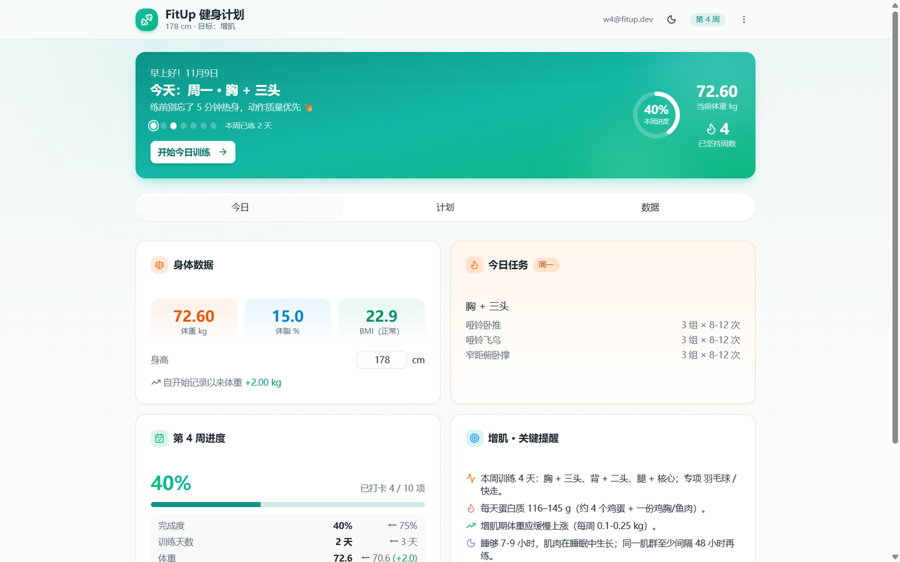
</div>

## ✨ 功能特性

- 🔐 **邮箱验证码登录** — passwordless，无需记忆密码
- 🎯 **个性化计划引擎** — 按目标（增肌/减脂/塑形/保持）、器械、训练频率、专项运动、伤病生成差异化一周计划
- 📈 **渐进超负荷** — 计划随周数自动进阶，并根据上周反馈难度动态调节
- 🔁 **动作替换** — 某个动作不想练？一键换成同肌群、同器械、避开伤病的平替，组数次数按当周进度换算，替换后自动清理该动作打卡、保留历史重量记录
- ✅ **打卡 + 记组** — 逐动作勾选；也可以只记重量/次数，保存后自动打卡，省掉再点一次的重复操作
- ⚖️ **身体数据追踪** — 体重/体脂记录与趋势图
- 🔄 **每周反馈** — 完成度、难度、酸痛、睡眠、饮食，完成度默认取本周真实打卡率，反馈驱动下周调整
- ⏱️ **组间休息计时器** — 记完一组自动倒计时，切页不中断，结束三连音 + 手机振动
- 📅 **训练日历** — 打卡、称重、反馈按月回看（中文月历）
- 🍗 **营养建议** — 按体重目标计算热量盈余/缺口与蛋白质摄入，从今日页一键打开
- 🧭 **三个一级入口** — 今日 / 计划 / 数据，路由化（`#/today`、`#/plan`、`#/data`）：刷新保持、返回键在 Tab 间回退
- 🔒 **用户数据隔离** — Supabase RLS 行级安全，每个用户只能访问自己的数据
- 📶 **离线 / 弱网不丢数据** — 云端读取失败期间，打卡 / 记组 / 体重 / 反馈仍写入本机缓存并标记待同步，刷新不丢；联网或点「重试」时整份重推，横幅显示待同步条数；读写加 8 秒超时，不会卡在启动页（页面本身仍需联网加载，应用壳离线未做）
- 📤 **数据可携带 / 可删除** — 设置弹层里可导出全部个人数据、自助删除账号（合规）；删除需原样输入登录邮箱确认，删除前检查未同步数据，失败即中止
- 📊 **CSV 导出** — 体重（含体脂 / BMI）、训练记录（按组展开）、本周打卡三张表，UTF-8 BOM + CRLF，Excel 直开不乱码；训练记录仅含当前周，弹层内已标注
- 💬 **意见反馈表单** — 反馈内容（≤500 字）+ 可选联系方式，满 5 字才可发送；`mailto` 不经任何服务器，也可一键复制粘到微信 / 邮件，二维码收进折叠区
- ♻️ **跨周自动续期** — 进入新自然周自动生成新计划，多周未打开可一次性补齐
- ✨ **界面打磨** — 今日页完成度只保留一处、关键提醒 5 条默认收为 2 条、深浅色小字统一可读性、空值补说明、动作示范视频加首帧 `poster`、移动端删除热区 44px
- 🌙 **现代前端体验** — 暗色模式、路由懒加载、移动端自适应；首屏 gzip ≈ 237KB（2026-11-04 基线）

## 📸 应用截图

### 桌面端

<div align="center">
  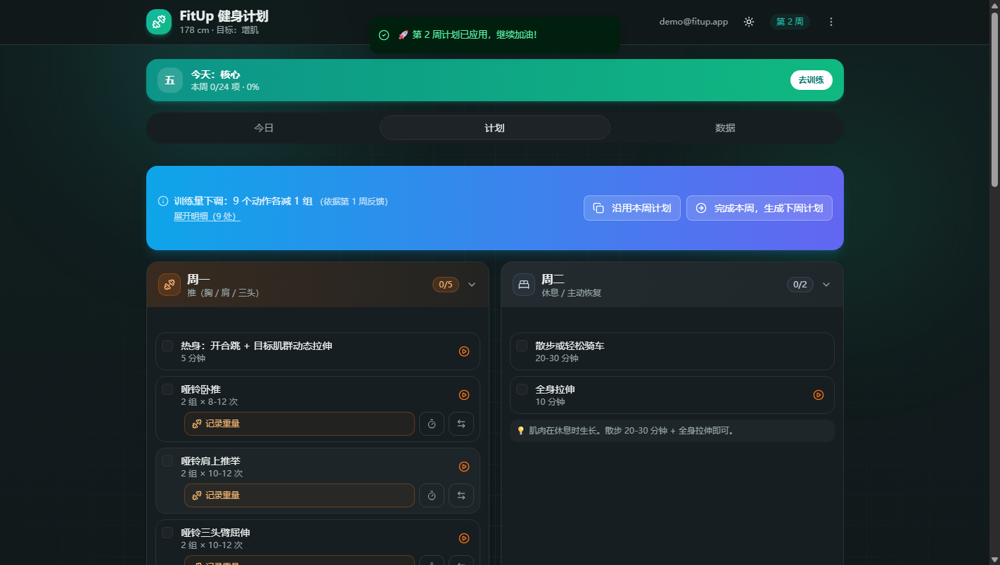
  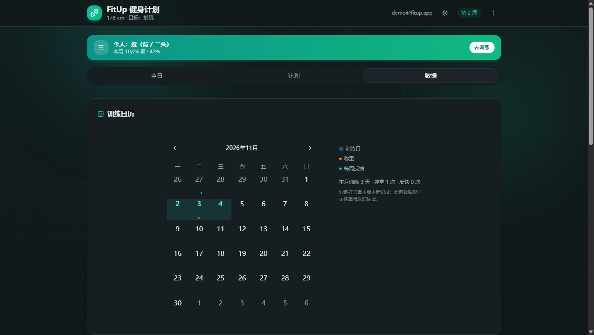
  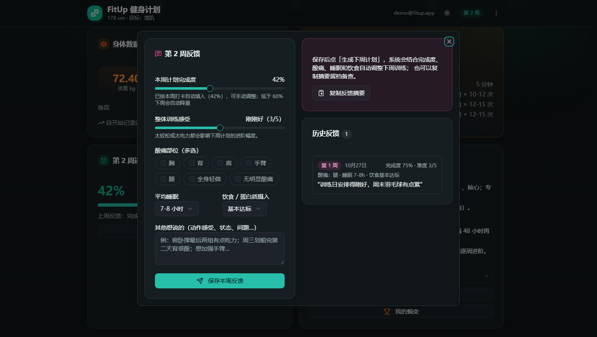
  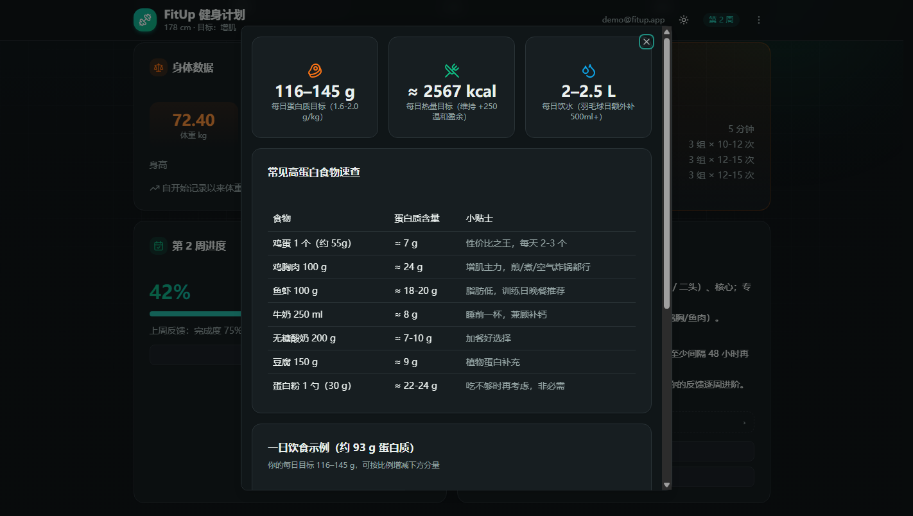
</div>

### 移动端

<div align="center">
  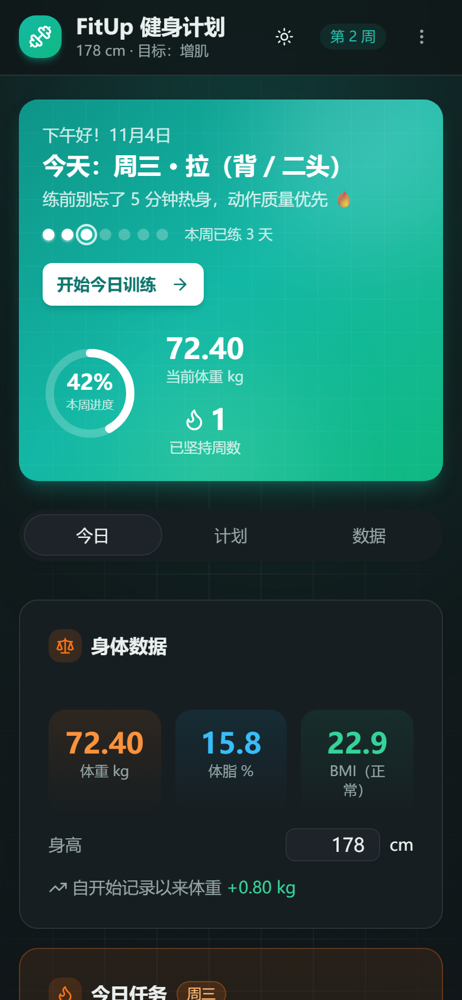
  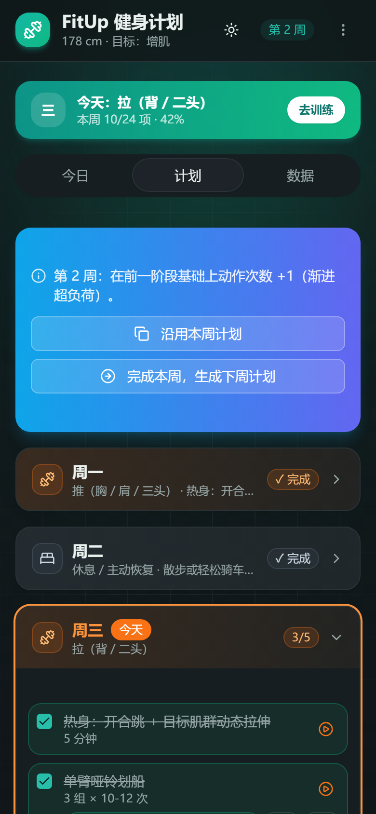
  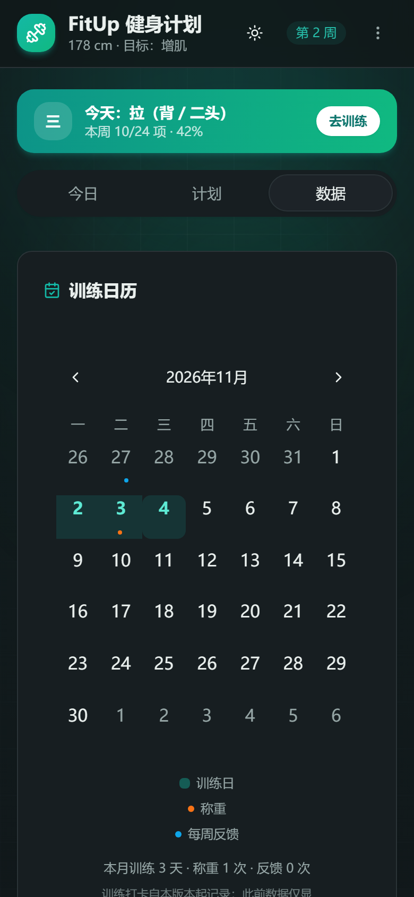
  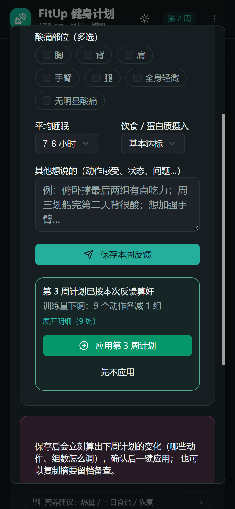
  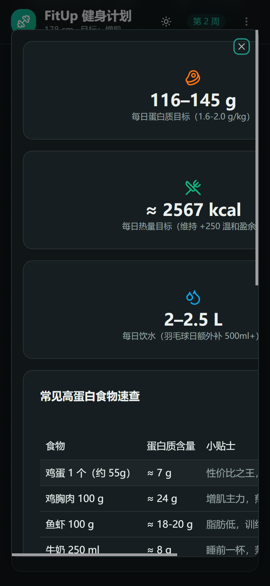
</div>

<details>
<summary>界面迭代对比（2026-11-10 · T8 打磨前后，点击展开）</summary>

「今日」页 1440px 浅色主题，**左为打磨前、右为打磨后**：进度卡去掉与英雄卡重复的大号 `%` / `已打卡 x/y` / 进度条并改名「本周 vs 上周」，关键提醒由 5 条收为 2 条 + 展开入口，卡片明显变短。

<div align="center">
  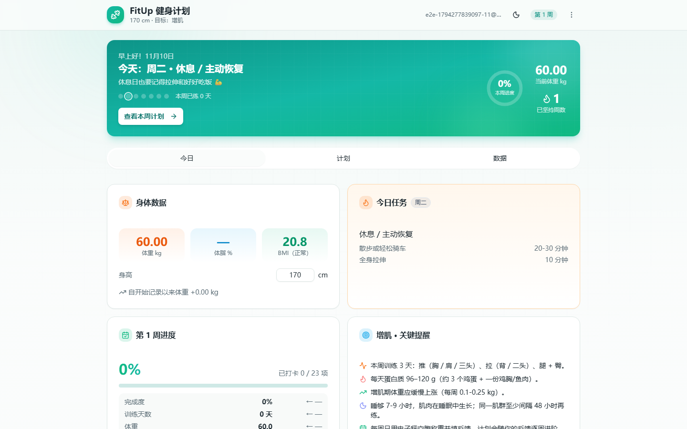
  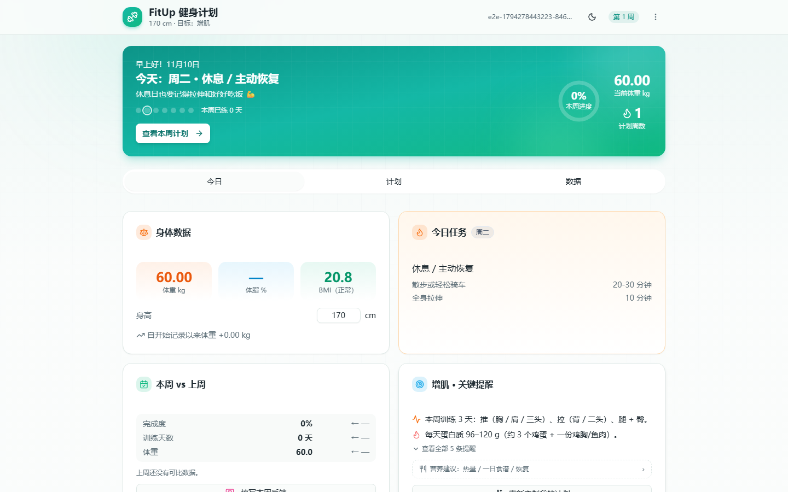
</div>

> 这两张是 dev server + mock 数据下的 Chromium 截图，用于展示布局变化而非真实数据；完整 390 / 1440 × 深浅色前后对比与展开态见 [`docs/e2e-screenshots/2026-11-10-ui/`](docs/e2e-screenshots/2026-11-10-ui/)。

</details>

## 🛠 技术栈

| 类别 | 技术 |
|---|---|
| 框架 | React 19、React Router 7 |
| 构建 | Vite 7、TypeScript 5.9 |
| 样式 | Tailwind CSS 3、shadcn/ui（Radix UI） |
| 后端 | Supabase（Auth + Postgres + RLS） |
| 可视化 | Recharts（懒加载，只在数据页下载） |
| 测试 | Vitest + Testing Library（339 个单元测试）；Playwright（4 条冒烟 + 3 条离线 + 3 条视觉，真实 Chromium + 本地 mock 后端） |
| CI/CD | GitHub Actions：`check`（lint + test + build）→ Pages 部署；PR 额外跑独立 `e2e` job；Supabase 每日保活 |

## 🚀 快速开始

**前置要求**：Node.js 18+，一个 [Supabase](https://supabase.com) 项目。

```bash
# 1. 克隆仓库
git clone https://github.com/Craftr-X/fitnessWeb.git
cd fitnessWeb/app

# 2. 安装依赖
npm install

# 3. 配置环境变量（填入你的 Supabase 凭据）
cp .env.example .env.local

# 4. 启动开发服务器
npm run dev   # http://localhost:3000
```

Supabase 配置（建表 + RLS + Auth）详见 [`app/README.md`](app/README.md)，建表 SQL 在 [`app/supabase/schema.sql`](app/supabase/schema.sql)。

## 📋 常用命令

```bash
cd app
npm run dev          # 开发服务器（http://localhost:3000）
npm run build        # 类型检查 + 生产构建
npm run test         # 单元测试（339 个）
npm run test:e2e     # Playwright 冒烟（4 条，真实 Chromium + 本地 mock 后端）
npm run test:offline # 弱网 / 离线端到端（3 条，含故障注入）
npm run test:visual  # 生成弹层 / 离线横幅 / UI 前后对比的 390/1440 深浅色截图留档
npm run lint         # ESLint
```

端到端用例在 `app/e2e/`，运行时由 Playwright 自动起两个服务：3100 端口的 dev server 与 54321 端口的本地 mock Supabase（**不写入真实后端**）；截图留档 `docs/e2e-screenshots/`。普通 `npm run dev` 仍是 3000 端口。

## 📦 部署

推送到 `main` 分支后，GitHub Actions 自动构建并部署到 GitHub Pages。完整部署步骤（含 Supabase SMTP / OTP 邮件配置）见 [`DEPLOY.example.md`](DEPLOY.example.md)。

线上后端为 Supabase 免费版，连续 7 天无 API 活动会被自动暂停（线上登录报 `Failed to fetch`）。仓库内置每日保活任务 [`keepalive.yml`](.github/workflows/keepalive.yml)，无需人工干预；若该任务报错，按日志提示到 Dashboard 手动 Resume 即可。

## 📂 项目结构

```
fitnessWeb/
├── app/                      # 前端应用
│   ├── src/
│   │   ├── lib/              # 核心逻辑（store 同步、planEngine、supabase、exportCsv、account）
│   │   ├── pages/            # 页面（Home、Auth、Onboarding）
│   │   ├── sections/         # 一级 Tab 区块（Overview、WeeklyPlan、BodyData 等）
│   │   ├── components/       # 业务组件（TodayHero、SettingsDialog、FeedbackDialog 等）
│   │   ├── components/ui/    # shadcn/ui 组件（按需保留，23 个）
│   │   ├── hooks/            # useAuth、useCountUp 等
│   │   ├── test/             # Vitest 单元测试（24 个测试文件 / 339 例）
│   │   └── types/            # TypeScript 类型定义
│   ├── e2e/                  # Playwright 用例（冒烟 / 离线 / 视觉）+ 本地 mock Supabase
│   ├── supabase/schema.sql   # 建表 + RLS 策略
│   ├── playwright.config.ts  # e2e 双 webServer 配置（dev 3100 + mock 54321）
│   └── README.md             # 开发详细文档
├── docs/                     # 技术方案、验收清单、推广截图与 e2e 视觉留档
├── review-2026-11-03/        # 一次完整走查报告（含截图，可删除）
├── .github/workflows/        # CI（check / e2e）+ CD（Pages 部署）+ Supabase 保活
└── DEPLOY.example.md         # 部署配置文档
```

## 🗒 更新日志

### 2026-11-06 → 11-10 · 最近迭代总览

一次完整走查之后连续合入的 8 个 PR 已全部落地，单测从 **231 → 339**。下面是速览，细节按轮次逐条展开（期间另有 [#49](https://github.com/Craftr-X/fitnessWeb/pull/49) 为方案文档，不计入功能迭代）。

| 方向 | 内容 | PR | 单测 |
|---|---|---|---|
| 反馈闭环 | 保存反馈后展示「下周会怎么变」并一键应用；云端读失败用本机缓存兜底，不再卡启动页 | [#48](https://github.com/Craftr-X/fitnessWeb/pull/48) | 231 → 246 |
| 计划可视化 | 今日页「本周 vs 上周」三行对比；「我的蜕变」入口按数据量收起 | [#50](https://github.com/Craftr-X/fitnessWeb/pull/50) | 246 → 254 |
| 数据可携带 | CSV 三张表（体重 / 训练记录 / 打卡），Excel 直开不乱码 | [#51](https://github.com/Craftr-X/fitnessWeb/pull/51) | 254 → 265 |
| 账号设置 | 菜单 5 → 3 项，导出 / 删除收进弹层；删除需输入邮箱确认，并补上 `flush()` 守卫 | [#52](https://github.com/Craftr-X/fitnessWeb/pull/52) | 265 → 274 |
| 反馈表单 | 可填写内容 + 联系方式，`mailto` / 复制双通道，二维码折叠 | [#53](https://github.com/Craftr-X/fitnessWeb/pull/53) | 274 → 287 |
| 工程验收 | Playwright 冒烟 4 条 + 本地 mock 后端 + CI 独立 `e2e` job + 12 张弹层截图 | [#54](https://github.com/Craftr-X/fitnessWeb/pull/54) | 287（不变） |
| 正确性 | 云端读失败期间改动落本机、刷新不丢、联网整份重推、8 秒写超时 | [#55](https://github.com/Craftr-X/fitnessWeb/pull/55) | 287 → 323 |
| 体验打磨 | 完成度去重、提醒折叠、可读性收敛、空态 / `poster` / 热区、12 张前后对比截图 | [#56](https://github.com/Craftr-X/fitnessWeb/pull/56) | 323 → 339 |

方案与验收清单：[T1–T7 总计划](docs/2026-11-06-next-tasks-plan.md) · [T7a 离线加固](docs/2026-11-09-t7a-offline-hardening-plan.md) · [T8 界面打磨](docs/2026-11-10-t8-ui-polish-plan.md)。

**已评估但明确不做**：Service Worker / PWA 应用壳离线、历史训练数据（当前 `setLogs` 只保留当前周）、T7b 按域分表 / 版本号 / 字段级冲突合并 —— 多设备并发仍是整文档 last-write-wins。

### 2026-11 · 一次完整走查后的重构

- **修复 6 个 P0**：训练日历塌陷成 131px / 月份英文（shadcn 组件用了 Tailwind v4 语法）、记组被预填的 0 阻断、蜕变弹窗超出视口、第 1 周「+0」文案、反馈完成度假默认值（导致 `<60%` 降阶规则永不触发）、「开始今日训练」不定位到今天
- **导航 5 → 3**：`今日 / 计划 / 数据`；每周反馈、营养建议降级为弹层，仍按需加载
- **英雄卡两态**：今日页完整版，计划/数据页压成一行 —— 移动端首屏占用 322px → 60px
- **计划页只展开今天**：日卡可折叠，移动端页高约 4300px → 1568px
- **Tab 路由化**：`#/today`、`#/plan`、`#/data`（HashRouter），刷新保持、返回键在 Tab 间回退
- **记组自动打卡**、**计时器振动**、**训练日历中文化 + 桌面两栏**
- **性能**：recharts 不再被首屏预加载、inspect 插件仅 dev 生效 —— 首屏 gzip **349KB → 237KB（−32%）**
- **清理**：删除 30 个没被引用的 shadcn 组件（−4199 行）与 20 个依赖；单测 225 → 231

### 2026-11-06 · 反馈闭环 + 首屏兜底

- **反馈闭环**：保存每周反馈后立刻显示「下周会怎么变」——例如「训练量下调：9 个动作各减 1 组」，
  可展开看到每个动作的 `3 组 → 2 组`，确认后一键应用；计划页顶部同样换成结构化摘要 + 明细
- **首屏兜底**：云端读取失败不再卡在「正在同步你的数据…」，也不会用默认值覆盖云端真实数据；
  失败时用本机缓存照常使用，顶部给「重试」
- **两处真实数据问题**：「已坚持周数」改用计划周数（此前会出现「第 16 周」配「已坚持 0 周」）；
  老用户没有训练目标时显示「目标：未设置」并提示补齐
- **文案**：第 2 周不再出现「动作次数 +0」，多段说明不再出现「。；」双标点
- 单测 231 → **246**（新增反馈闭环全链路、加载失败兜底等用例）

### 2026-11-09 · 今日页「本周 vs 上周」

- **三行对比**：「第 N 周进度」卡里那句「上周反馈：完成度 75%」升级为**完成度 / 训练天数 / 体重**三行对比，
  本周值实时计算、上周值并列展示；体重差值按目标着色（增肌涨为好、减脂降为好）。
  第 1 周显示「上周还没有可比数据」，而不是一排 `—`
- **「我的蜕变」入口按数据量收起**：不足 4 周或体重记录 <2 条时不显示入口（海报本就没有内容可讲），
  数据够了自动恢复显示；弹窗空态文案同步更新
- 单测 246 → **254**（新增 `weekCompare` 纯函数 5 例、蜕变入口收起 3 例）

### 2026-11-09 · CSV 导出（体重 / 训练记录 / 打卡）

- **三张表**：体重（含体脂 / BMI）、训练记录（按组展开重量与次数）、本周打卡（按整周计划展开，未勾也记「否」）；
  页头菜单「导出 CSV」→ 弹层三选一，文件名形如 `FitUp-体重-20261109.csv`
- **Excel 直开**：UTF-8 BOM + CRLF，中文表头不乱码；含逗号、引号、换行的字段自动转义，空数据只输出表头
- **数据边界**：`setLogs` 只保留当前周，导出的训练记录即现有数据，已在弹层内标注「仅包含当前周」
- 单测 254 → **265**（新增 `exportCsv` 11 例）

### 2026-11-09 · 账号设置弹层（T4）

- **页头菜单 5 → 3 项**：只留「意见反馈 / 设置 / 退出登录」；「导出我的数据」「导出 CSV」「删除账号」
  全部收进设置弹层，两个红色危险项不再并排出现
- **删除账号改为输入邮箱确认**：需原样输入登录邮箱（忽略首尾空格与大小写）才能点「确认删除」，
  替代原来的菜单直达 + AlertDialog 二次确认，避免三重确认；退出登录仍保留二次确认
- **修一个数据同步缺口**：删除前 `flush()` 返回 false 时（云端读取失败期间必然为 false）现在会中止并提示，
  此前忽略返回值继续删云端行，可能在数据未同步时把云端行删掉；删除顺序抽到 `account.ts` 并补了失败路径用例
- 单测 265 → **274**（新增 `SettingsDialog` 6 例、`deleteAccount` 3 例）

### 2026-11-09 · 意见反馈改成可填写的表单（T3）

- **表单成为主路径**：反馈内容（≤500 字）+ 可选联系方式（≤60 字）+ 字数计数，满 5 字才可发送；
  点击「发送反馈」打开系统邮件客户端（mailto，不经任何服务器），也可一键复制内容粘到微信 / 邮件
- **二维码降级为折叠区**：用原生 `<details>`，不新增依赖；手机端扫自己屏幕不成立的问题不再挡住反馈
- **兼容两种入口**：登录页「收不到验证码？点这里反馈」的非受控 `trigger` 模式、页头菜单的受控
  `open` 模式都保留；剪贴板不可用时降级为选中正文 + 提示，弹层 `max-h-[90dvh]` 可滚动
- 单测 274 → **287**（新增 `feedbackDialog` 10 例、`feedback` 纯函数 3 例）

### 2026-11-09 · Playwright 冒烟与视觉验收补齐（T6）

- **真实 Chromium 兜底**：新增 `app/e2e/mock-supabase.mjs`（54321，模拟 OTP / verify / `user_data`，
  无数据返回 `200 []`，含 `POST /__reset`）与 `app/playwright.config.ts`（mock 54321 + dev 3100 两个 webServer）。
  4 条端到端用例覆盖登录引导 / 记组打卡 / 反馈应用 / 路由刷新，`npm run test:e2e` 本地**连跑 3 次全绿**
- **CI 独立 `e2e` job**：仅 PR 触发、`needs: check`，不拖慢单测、不阻塞 Pages 部署
- **视觉验收补齐**：用同一套 Chromium 生成 T5 CSV / T4 设置 / T3 反馈三个弹层的
  390 / 1440 × 深浅色共 **12 张截图**，留档 `docs/e2e-screenshots/2026-11-09/`；`npm run test:visual` 可复现
- 单测数保持 **287**（e2e 用例不计入 Vitest）

### 2026-11-10 · 离线 / 弱网写入加固（T7a）

- **修掉「刷新即丢」**：云端读取失败（`loadError`）期间，打卡 / 记组 / 体重 / 反馈原本连本机缓存都不写，
  只存在 React 内存里，刷新就丢；现在改动始终落本机并置 dirty，但**仍禁止自动回写云端**（防旧缓存覆盖）
- **重试与联网**：有未同步改动时点「重试」或触发 `online` 事件改为「整份重推」，不再用远端旧数据冲掉离线写入；
  横幅如实显示待同步条数与「本机版本将覆盖云端版本」
- **不再卡死**：`saveUserData` 加 8 秒超时（迁移分支不会永久停在 splash），`getSession()` reject 时也会结束加载态
- **弱网可回归**：mock 后端新增 `POST /__fault`（offline / slow / error），3 条 `@offline` 端到端用例覆盖
  「断网记组 → 刷新仍在 → 联网重推」「删号后不重放复活」「慢网读超时不卡 splash」；CI 的 `e2e` job 一并跑
- 单测 287 → **323**（新增 36 例）；新增 4 张离线横幅截图留档 `docs/e2e-screenshots/2026-11-10/`
- **仍未解决**：整文档 last-write-wins，多设备并发时离线一方重推仍可能覆盖另一设备的写入；
  Service Worker / 应用壳离线缓存也不在本轮（见 `docs/2026-11-09-t7a-offline-hardening-plan.md` §5）

### 2026-11-10 · 页面整洁与体验打磨（T8）

- **数字去重**：「今日」Tab 原本同屏出现大号完成度 `%`、`已打卡 x/y`、进度条与对比行四处重复；
  现在完成度只由英雄卡进度环呈现，原卡片改名「本周 vs 上周」，只留三行对比与「填写本周反馈」入口
- **关键提醒折叠**：5 条长文案默认只显示最相关的 2 条，点「查看全部 5 条提醒」展开；
  状态只放 React 内存，**不新增 localStorage key**，删号 / 切账号的清理逻辑不变
- **可读性**：全站 28 处 `text-[10px]` / `text-[11px]`、`text-white/40…80`、`text-muted-foreground/60·/70`
  统一回到 `text-xs` / `text-white/90` / `text-muted-foreground`，深浅色小字不再发灰
- **空态与弱网**：体重 / 体脂 / BMI / 近 7 天变化的空值补说明文案；动作示范视频复用同组备用静态图
  作 `poster`，弱网下不再只有黑块加转圈；记组弹窗与历史记录删除按钮热区提到 44px
- **视觉验收**：`app/e2e/visual-ui-polish.spec.ts` 用同一份 spec 在改动前后各跑一次，
  390 / 1440 × 深浅色共 4 组前后对比 + 4 张展开态截图，留档 `docs/e2e-screenshots/2026-11-10-ui/`
- 单测 323 → **339**（新增 16 例）；`lint` 0 error、`build` 通过、`@smoke` 连跑 3 次全绿、
  `@offline` 3 条全绿、`@visual` 3 条全绿
- 方案与验收清单见 `docs/2026-11-10-t8-ui-polish-plan.md`；**本轮不含** SW / PWA、历史训练数据、
  数据层重构与 T7b

## 🤝 参与贡献

欢迎提交 Issue 和 Pull Request！

1. Fork 本仓库
2. 创建特性分支：`git checkout -b feat/amazing-feature`
3. 提交改动：`git commit -m "feat: add amazing feature"`
4. 推送分支：`git push origin feat/amazing-feature`
5. 发起 Pull Request

提交前请确保 `npm run lint` 和 `npm run test` 全部通过。

## 📄 License

基于 [Apache License 2.0](LICENSE) 开源。

---

<div align="center">
  如果这个项目对你有帮助，欢迎 ⭐ Star 支持一下！
</div>
