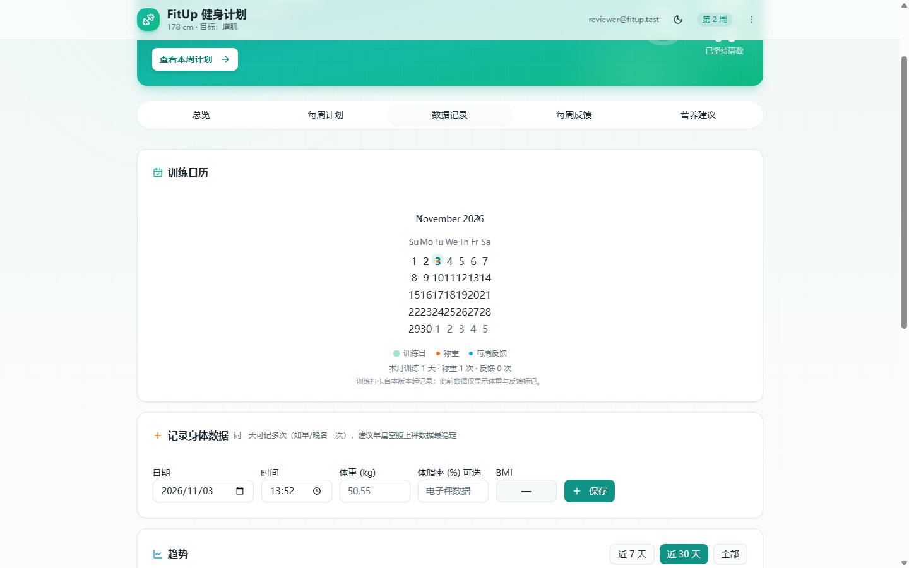
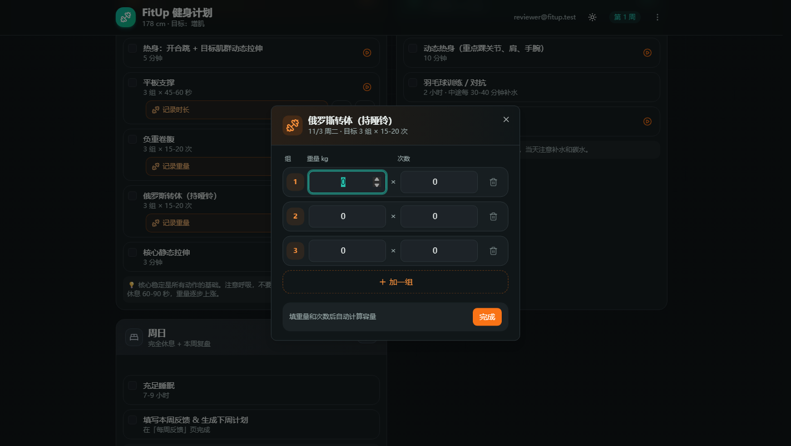
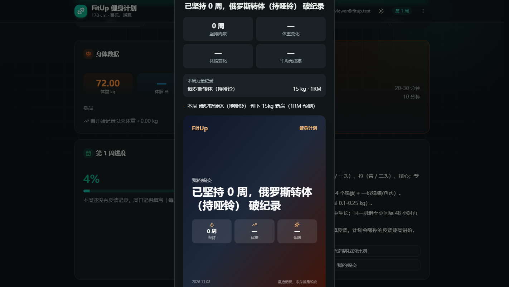
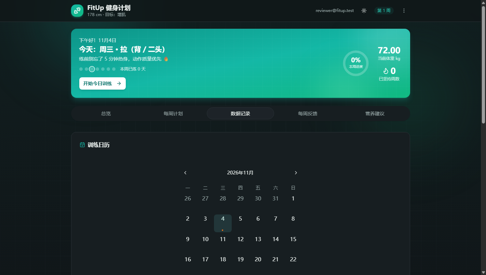
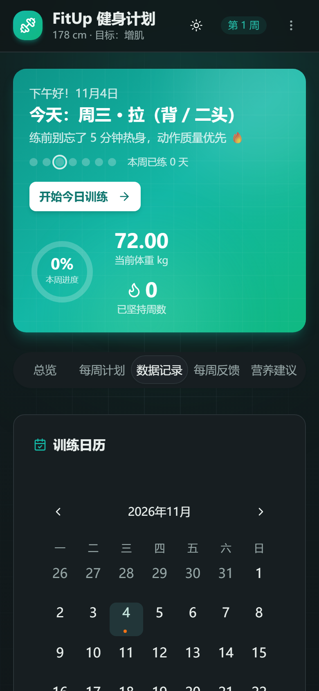
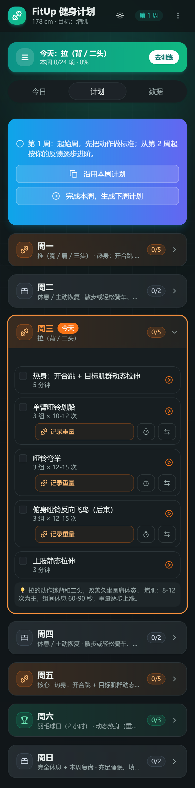

# FitUp 走查报告 · 2026-11-03

> 方式：本地起 dev server（`app/`，Vite 127.0.0.1:3000），后端用**本地 Supabase 替身**（模拟 `/auth/v1/otp`、`/auth/v1/verify`、`/rest/v1/user_data`），用 Chrome headless + CDP 真实点击走完整流程。
> 视口：桌面 1440×900，移动 390×844 / 360×780。
> 已走通：邮箱验证码登录 → 2 步引导（生成计划）→ 5 个 Tab → 打卡 → 记组（重量/次数）→ 组间计时 → 动作示范 → 换动作 → 记录体重 → 每周反馈 → 生成第 2 周 → 蜕变海报 → 菜单 / 主题切换 / 移动端。
> **未验证**：真实 Supabase 后端（RLS、错误码、邮件送达）、跨设备同步、导出文件内容、真实动作视频外链。
> 走查过程中发现 `node_modules` 缺 `html-to-image`（`package-lock` 里有），导致首页 `Overview` 动态导入 500、直接落到 ErrorBoundary 白屏 —— 已在本地补装，仓库未改动（`package.json` 本来就有）。

> **更新 2026-11-04**：第二节的 6 个 P0 已全部修完（P0-6 只做了"定位到今天"，Tab 路由化按计划留到第 3 周）。`lint` 0 error、单测 227 全绿（+2 条新断言）、`build` 通过，浏览器回归截图见文末「修复记录」。

---

## 一、先说结论

产品闭环是完整的（画像 → 计划 → 打卡/记组 → 反馈 → 下周计划），工程底子明显好于同类个人项目。**真正的问题不是缺功能，而是功能全挤在同一层**：5 个 Tab、常驻英雄卡、每个动作 4 个可点元素、每页都在重复同一批数字。移动端（训练时唯一的真实场景）首屏 59% 被英雄卡占掉，看一次今日训练要滑 1.5 屏。

所以优化主线建议是 **「减层级 + 减重复」**，而不是继续加功能：

| 方向 | 现在 | 建议 |
|---|---|---|
| 导航 | 5 个 Tab，单页 state 切换，刷新即回总览 | 3 个主 Tab + 路由 |
| 首屏 | 322px 英雄卡 + 4 张卡片 | 今日一屏完成，其余折叠 |
| 计划页 | 7 天全展开、每个动作 4 个入口 | 默认只展开今天 |
| 营养 | 独立 Tab、纯静态文案 + 表格 | 降级为卡片/抽屉 |
| 蜕变海报 | 常驻二级入口、分享图 | 收进"成就"，或先下线 |

---

## 二、必须先修的问题（P0）

### P0-1 训练日历塌成 131px，日期数字重叠、月份还是英文

- 现象：桌面端卡片宽 ~1000px，日历表格只有 **131px**，单元格 19px，`10 11 12 13 14` 直接叠在一起；月份表头是 `November 2026`、星期是 `Su Mo Tu We Th Fr Sa`；看不到上一月/下一月按钮。
- 原因：`app/src/sections/BodyData.tsx:80` 用 `
` 包住 `<Calendar>`，宽度被压到内容最小宽度；同时没有给 react-day-picker 传 `locale={zhCN}`（`date-fns/locale` 已是依赖）。
- 建议：去掉 `w-fit`，改 `w-full` + 单元格固定尺寸（`--rdp-day-width: 2.25rem` 之类），补 `locale={zhCN}` 和月份切换按钮。这是全站最"像是坏了"的地方，优先级最高。

### P0-2 记组弹窗被"0"卡住，少做一组就存不了

- 现象：弹窗按计划组数预填 3 行，值都是 `0 × 0`。只做了 1 组就点「完成」→ 报错「第 2 组的重量和次数为 0，请填写实际数值后再完成」，必须逐行删掉多余组才能保存。
- 原因：`app/src/sections/WeeklyPlan.tsx:203` 的校验把 `0` 当成"未填"且要求**每一行**都合法；而 `store.pruneEmptySets` 本身已经会剔除空组，逻辑重复且更严。
- 建议：保存时自动 `pruneEmptySets`（全空则提示"还没填"），或允许多余行留空直接忽略。训练现场少一组是常态，不该阻断。

### P0-3 「我的蜕变」弹窗比屏幕还高，标题被顶出可视区

- 实测：390×844 下弹窗 `top = -33`、`height = 911`，标题和说明整块在屏幕外；桌面端同样溢出。
- 建议：`max-h-[90dvh]` + 内部滚动，或把海报预览改成 `aspect-[3/4]` 受限高度。

### P0-4 第 1 周的文案和按钮语义不对

- 计划页横幅写「第 1 周：在前一阶段基础上动作次数 **+0**（渐进超负荷）」——第 1 周没有"前一阶段"，`+0` 让规则引擎看起来像没生效。
- 「复制上周计划」实际执行的是「把**本周**复制成下周」（toast 也是这么写的），第 1 周时更是无从"上周"。
- 建议：第 1 周换成引导语（"这是你的起始周，先把动作做标准"）；按钮改名「沿用本周计划」。同时 `buildNextWeekPlan` 在无反馈时基本原样返回，用户点「完成本周」后看到一模一样的计划和 `+0`，会以为没生效 —— 建议提示"未填反馈，本周按原计划顺延"。

### P0-5 每周反馈的「计划完成度」默认 80%，和真实 0% 打架

- `app/src/sections/Feedback.tsx:37` `useState(80)`；而此时首页显示已打卡 0/24。
- 危害不只是"显示不一致"：`buildNextWeekPlan` 里有一条 `if (feedback.completion < 60) → 下周降阶`（`planEngine.ts:646`）。默认 80% 会让这条规则**永远不触发**，用户一路默认点下去，等于用假数据训练计划引擎。
- 建议：默认取真实完成度（`done / total`），并标注"已按本周打卡自动填入，可修改"。

### P0-6 「今日训练」不定位到今天，Tab 也不是路由

- 英雄卡 CTA 只做 `setTab('plan')`（`app/src/pages/Home.tsx:386`），落地在计划页顶部；周三/周五的用户要先滑过 2~4 张日卡才找到今天。
- 整个应用只有一个路由 `/`（`App.tsx`），Tab 是本地 state：刷新回到总览、返回键直接退出、没有可分享链接。
- 建议：计划页支持 `?day=`/锚点滚动 + 今日卡默认高亮置顶；Tab 换成 `/today`、`/plan`、`/data` 三个路由。

### 顺带：移动端 5 个 Tab 不吸顶

- 实测 390×844：英雄卡 322px，Tab 条距顶 430px，正文从 ~500px 才开始；滚到计划页中部想切 Tab，必须回到顶部。
- 建议：Tab 条 `sticky top-14`，或移动端换成底部导航（训练场景单手可达）。

---

## 三、简化建议（本次重点）

### S1 导航从 5 个降到 3 个

| 现在 | 处理 | 理由 |
|---|---|---|
| 总览 | **合并进「今日」** | 总览和计划页都在讲"本周进度/今天练什么"，信息重合度 ~60% |
| 每周计划 | **保留为「计划」** | 核心页面 |
| 数据记录 | **保留为「数据」**（体重 + 日历 + 趋势） | 核心页面 |
| 每周反馈 | **改成收尾流程**：周日 / 本周完成时弹出，或从今日卡进入 | 一周用一次的表单占 1/5 导航，权重过高 |
| 营养建议 | **降级**：今日卡片里一行"今日蛋白 115-144g"→ 点开抽屉看全表 | 纯静态内容，零交互，却占一个一级入口 |

结果：`今日 / 计划 / 数据` 三个入口，反馈和营养变成"从今日进入的二级页面"。一次性砍掉 40% 的导航宽度，也解决移动端 Tab 拥挤（360px 下现在已经贴边了）。

### S2 英雄卡按场景变形

现在是全站常驻，且带「查看本周计划」按钮（已经在计划页时这个按钮毫无意义）。

- 总览/今日：保留完整版（问候 + 今天 + 进度环 + 体重 + 坚持周数）。
- 其他 Tab：压缩成一行 sticky 小条（`今天：周五 · 肩 + 核心 · 3/5`），或直接不显示。
- 数字去重：英雄卡的进度环、`第 N 周进度` 卡、`已打卡 x/y` 三处在说同一件事，留一处即可。

### S3 计划页默认"只看今天"

- 现在 7 天全展开 + 每个动作下面挂「记录重量 / 计时 / 换动作」，桌面 2632px、移动更长；`app/src/sections/WeeklyPlan.tsx` 851 行也主要是在渲染这张长表。
- 建议：默认展开"今天"，其余 6 天折叠为一行摘要（`周一 · 推 · 0/5 ›`）；"记录重量"从常驻大按钮改为动作行右侧图标（有小字摘要提示"上次 20kg×8"），点开才进弹窗。
- 副作用：动作行从 4 个可点元素降到 2 个（勾选 + 展开），误触率明显下降。

### S4 数据页收拢为三块，图表按需加载

- 现在：日历 + 记录表单 + 趋势（4 个统计块 + 图）+ 历史表格，一屏塞不下；打开这个 Tab 就要下载整个 recharts（100KB+ gzip），而图要 2 条记录才出现。
- 建议：日历做紧凑月历（`locale=zhCN`，"训练/称重/反馈"三种点用图例），表单收进「+ 记录」弹层，recharts 用 `React.lazy` 到真正画图时再加载。

### S5 「我的蜕变」海报：先下线或收进二级

- 它是增长功能，不是训练功能：现在冷启动就是用 1 条记录生成"已坚持 0 周，XX 破纪录"的空海报（见截图），观感反而扣分；还额外带来 html-to-image 依赖、超出视口的弹窗、`demos`/`transformation` 两套逻辑。
- 建议：挪到菜单里的「成就」，或直接下线，等有 4 周以上真实数据再回来。

### S6 「意见反馈」改成能写字

- 现在点开只有一张微信群二维码 + QQ 邮箱。桌面端还能扫，**手机端扫自己屏幕不成立**；而它在登录页是"收不到验证码？点这里反馈"的唯一出口。
- 建议：弹窗里放 3 行文本 + 提交（存 `feedback` 表或直接 `mailto:`），二维码作为补充。

---

## 四、逐页细节清单

**登录页**

- 视觉很好，暗色 + 极光 + 粒子，比多数同类产品精致。
- 验证码 `onComplete` 自动提交（`Auth.tsx:276`），但没有"正在验证"的骨架，网络慢时会有 1~2 秒无反馈。
- 「收不到验证码？点这里反馈」→ 见 S6。

**引导页**
- 2 步、默认值齐全，能一路下一步，阻力很小。✅
- 画像预览（`describeProfile`）只输出 `男 · 25 岁 · 178cm · 72kg · 目标增肌 · 3 天/周 · 新手`，**不含器械/专项运动/伤病**——而这三项恰恰最影响计划。建议补上，用户才会相信自己选对了。
- 引导不可跳过。如果想拉低门槛，可以给"先随便生成，稍后微调"。

**今日 / 总览**
- 「增肌 · 关键提醒」5 条长文案，移动端占满一屏；建议折叠成 2 条，其余进"详情"。
- 「重新定制我的计划」「我的蜕变」两个按钮放在最底部，移动端要滑到底才看得到——定制入口更适合放菜单。
- 勾选 1 个动作，英雄卡就显示「本周已练 1 天」（`Home.tsx:213` 按"当天有任一勾选"算一天），语义偏松。

**每周计划**
- 每个动作的 `记录重量 → 完成` 保存成功后**不会自动勾选**，用户要再点一次勾，属于重复劳动（`WeeklyPlan.tsx:808` 只写 setLogs）。
- 组间计时器体验好：悬浮胶囊、切 Tab 不中断、60/75/90/120 预设，结束时还有 WebAudio 三连音。✅ 小建议：手机静音时听不到，可补一次 `navigator.vibrate`。
- 「加一组」会复制上一组数值（合理），但删除按钮在移动端 40px 热区偏小。
- 动作示范弹窗依赖外链视频，弱网下只剩转圈；建议给视频加 `poster` 或静态首帧。

**数据记录**
- P0-1 日历是硬伤。
- 体重输入框占位符是 `50.55`（老模板残留数值），容易被当成"当前体重"。
- 同一天记两次时，x 轴两条标签分别是 `11/3` 和 `11/3 13:52`，长短不一、容易看成重复；建议统一成 `M/d HH:mm` 或按天聚合。
- BMI 实时算但只在有体重时出现，空态是一个 `—`，可以补一句"填体重后自动计算"。

**每周反馈**
- P0-5 默认值问题。
- 酸痛部位用 chip 多选，直观。✅
- 「复制反馈摘要」很实用，但和次要操作混在一起，可考虑放进"历史反馈"卡片。

**营养建议**
- 纯静态：3 个数字 + 7 行食物表 + 5 行食谱 + 4 条恢复建议；数字与总览"关键提醒"重复。
- 建议整块降级（S1），其中"今日蛋白目标"合并进今日卡。

**全局**
- 菜单里「删除账号」和「退出登录」都是红色，只隔一条分割线，误触成本太高；建议删除账号进"设置"，并要求输入邮箱确认。
- 桌面端头部显示完整邮箱，移动端隐藏（合理）。
- 360px 下标题被截成 `FitUp 健身…`，可以把副标题"178cm · 目标增肌"合并进标题行。
- 深色/浅色都做了，浅色下青色主色对比度偏弱（浅色截图里 `115-144 g` 的说明文字偏灰）。

---

## 五、工程债（不影响体验，但影响后续速度）

1. **30 / 53 个 shadcn UI 组件没被引用**（accordion、carousel、command、sidebar、table、chart…）。虽然被 tree-shake 掉不进包，但每次升级 shadcn 都要跟着改，建议直接删。
2. **首屏依赖偏重**：`BodyData.tsx` 顶部直接 `import recharts`，所以点开「数据」就要下 100KB+(gzip) 的图表库，而趋势图要 2 条记录才出现。建议 `React.lazy` 到真正画图时再加载。（注：仓库里的 `app/dist` 是 8 月的旧产物，包体数字没有参考价值，这里不做绝对值引用；自己跑一次 `npm run build` 看现状即可。）
3. **巨型文件**：`WeeklyPlan.tsx` 851 行（列表 + 3 个弹窗）、`planEngine.ts` 850 行、`demos.ts` 910 行静态数据、`Home.tsx` 511 行（英雄卡 + 5 个 Tab + 3 个确认弹窗）。建议按"列表 / 弹窗 / hooks"拆。
4. **数据层是整文档 last-write-wins**（`store.ts` 注释里也写了）。多端同时改会互相覆盖，建议后续加 `updated_at` 版本号或按域分表。
5. **测试结构很好**（225 个，含 planEngine/store/记组交互），但 `Overview`、`Nutrition`、`BodyData` 没有渲染测试——P0-1 这种"日历塌了"的问题，一个 `screen.getByRole('grid')` 快照就能挡住。
6. 本地 `node_modules` 与 `package-lock` 不一致（缺 `html-to-image`）会让首页直接白屏。建议 CI 里加 `npm ci`，或在 README 注明"拉代码后先 `npm ci`"。

---

## 六、建议排期

**第 1 周：止血**（预计 1~2 天改动量）
1. P0-1 日历（半小时级）
2. P0-2 记组弹窗放行空组
3. P0-3 蜕变弹窗高度
4. P0-4 第 1 周文案 + 按钮改名
5. P0-5 完成度默认值

**第 2 周：简化骨架**
6. S2 英雄卡变形（其他 Tab 收成一行）
7. S1 导航 5 → 3（反馈/营养降级）
8. S3 计划页默认只展开今天
9. 菜单里把「删除账号」挪走

**第 3 周起：结构**
10. Tab 路由化（`/today`、`/plan`、`/data`）
11. 记组成功自动勾选 + 计时器声音
12. S5 蜕变下线 / S6 反馈表单
13. 清理 30 个未用 UI 组件

---

## 七、一句话

功能不缺，缺的是"今天打开就能练完"的那一条最短路径：**把 5 个 Tab 收成 3 个、英雄卡按场景变形、计划页默认只给今天**，再把日历、记组、蜕变这三个硬伤修掉，体验会有一个数量级的跃升。

---

## 八、修复记录（2026-11-04）

6 个 P0 已修，改动集中在 9 个文件（+96 / −29），`lint` / `test`（227）/ `build` 全绿。

| # | 修复方式 | 改动文件 |
|---|---|---|
| P0-1 | `calendar.tsx` 把 shadcn **v4 语法**（`[--cell-size:--spacing(8)]`、`size-(--cell-size)`）换成 v3 可识别的写法，root 由 `w-fit` 改 `w-full`；`BodyData` 外层 `mx-auto w-full max-w-sm` + `locale={zhCN}`、体重占位符 `50.55` → `如 72.5` | `components/ui/calendar.tsx`、`sections/BodyData.tsx` |
| P0-2 | `handleDone` 只校验"已填写到的最后一行"，末尾空组直接忽略（落库时 `pruneEmptySets` 会剔除）；中间留空仍精确报错 | `sections/WeeklyPlan.tsx` |
| P0-3 | 弹窗 `max-h-[90dvh] overflow-y-auto`，海报不再把标题顶出屏幕 | `components/TransformationDialog.tsx` |
| P0-4 | 第 1 周改为"起始周"文案，不再出现 `+0`；「复制上周计划」→「沿用本周计划」（toast / 注释 / 落库文案同步） | `lib/planEngine.ts`、`sections/WeeklyPlan.tsx` |
| P0-5 | 完成度默认值改为本周真实打卡率，并在滑块下标注"已按本周打卡自动填入" | `sections/Feedback.tsx`、`pages/Home.tsx` |
| P0-6 | 「开始今日训练」切 Tab 后把今天那张日卡滚进视口（`focusToday` 计数器 + `fitup-today-day` 锚点 + `scroll-mt-24`） | `pages/Home.tsx`、`sections/WeeklyPlan.tsx` |

顺带修掉同源的坑：`select.tsx` / `dropdown-menu.tsx` 里也有 v4 语法（`max-h-(--radix-…)`、`origin-(--radix-…)`），Tailwind 3 下同样不生效——表现是**长列表的下拉菜单没有 max-height，会溢出屏幕**。已一并换成 `[var(--…)]` 写法。其余尚未使用的 shadcn 组件（tooltip / popover / sidebar / chart 等）还有同类写法，留到「清理 30 个未用组件」时一起处理。

回归验证（无头浏览器实测）：

- 日历：表格宽 **131px → 360px**，单元格 **19px → 36px**，表头 `2026年11月`、星期 `一二三四五六日`，翻月箭头可见（桌面与 390px 移动端均正常）。
- 记组：只填第 1 组 → 保存成功、弹窗关闭、入口显示 `本次：20kg×10 · 1组`、组间计时自动开始。
- 蜕变弹窗：`top 40 / height 724 ≤ 视口 804`，标题可见（修复前 `top −33 / height 911`）。
- 反馈：滑块默认 `0%`（与真实 0/24 一致），不再是 80%。
- CTA：点「开始今日训练」→ 切到计划 Tab 并滚到 `scrollY=1038`，今天那张卡顶部落在 88px（吸顶头之下）。

**下一步**（第 2 周骨架）：英雄卡按 Tab 变形 → 导航 5→3 → 计划页默认只展开今天。

---

## 九、第 2 周骨架（2026-11-04）

已落地，改动 4 个文件（+340 / −250 左右），`lint` / 227 测试 / `build` 全绿。

| 建议 | 落地方式 | 实测效果（390×844） |
|---|---|---|
| S1 导航 5→3 | Tab 收成 `今日 / 计划 / 数据`；`每周反馈` 改成从今日页「填写本周反馈」进入的弹层，`营养建议` 改成关键提醒卡里的文字链弹层（都保留懒加载） | 每个 Tab 宽度从 71px 提到 130px，360px 下不再贴边 |
| S2 英雄卡变形 | 抽出 `components/TodayHero.tsx`，`compact` 模式压成一行（周几 + 今天练什么 + 本周 n/m + 去训练） | 计划页英雄卡 **322px → 60px**，Tab 条距顶 **430px → 160px**，正文直接进第一屏 |
| S3 计划页只展开今天 | 日卡头部变成折叠开关（`aria-expanded`），折叠时仍显示「练什么 · 前两个动作 · 完成度」；移动端默认只展开今天，桌面端保持全展开 | 计划页总高 **约 4300px → 1568px**，7 张日卡里只展开今天那张 |

另外：`第 N 周进度` 卡里新增「填写本周反馈」按钮，`关键提醒` 卡底部新增「营养建议：热量 / 一日食谱 / 恢复」入口——两个降级的页面都有了明确入口，不会变成"藏起来的功能"。

**下一步**（第 3 周结构）：Tab 路由化（`/today`、`/plan`、`/data`，支持刷新保持与返回键）→ 记组成功自动勾选 → 计时器补振动 → 清理 30 个未用 UI 组件。

---

## 十、第 3 周（2026-11-04）

| 项 | 落地方式 | 验证 |
|---|---|---|
| Tab 路由化 | `#/today` `#/plan` `#/data`（项目本来就用 `HashRouter`，GitHub Pages 上深链接刷新不会 404）；`Home` 从 URL 派生当前 Tab，未知路径（含 `#/`）回落今日；`App` 路由从 `path="/"` 改成 `path="*"` 只做登录闸门 | 点「计划」→ `#/plan`；在 `#/plan` 刷新仍在计划页；返回键在 Tab 之间回退，应用不退出 |
| 记组自动打卡 | 保存训练记录后自动勾选该动作（已勾选时不再 toggle，避免误取消） | 保存 22.5kg×10 → 该行变绿划掉、日进度 1/5、顶部 本周 1/24 · 4% |
| 计时器振动 | 休息结束在前三连音之后 `navigator.vibrate([120,80,120])`，无实现（iOS/桌面）走可选链静默跳过 | 新增 2 个单测：有 `vibrate` 时被调用、没有时不抛错 |
| 清理未用组件 | 删除 30 个从未被引用的 shadcn 组件（`accordion`/`carousel`/`command`/`sidebar`/`table`… ），`components/ui` 53 → 23 | lint / build 通过，无悬空引用 |

测试数从 227 → **231**（+2 自动打卡、+2 振动）。

**还没做**（可继续）：`package.json` 里随组件一起失效的依赖（`vaul`、`cmdk`、`embla-carousel-react`、`react-resizable-panels` 等）没删，需要 `npm install` 更新 lockfile，留到下次一起处理；`index` 主包 511KB(gzip 161KB) 仍然偏大，图标按需引入是下一步性价比最高的优化。
